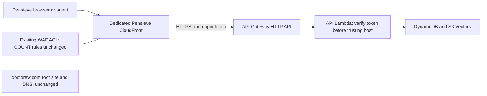

# AWS runtime infrastructure

Implementation scope: AC10/11 in SPEC.md. Terraform owns one DynamoDB table, private versioned S3 snapshot bucket, S3 Vectors bucket/index, API and worker Lambda functions, IAM roles, HTTP API ingress, Cognito identity, failure queue, short-retention logs, a queue alarm and budget notifications. No NAT gateway, ALB, Aurora, ECS/Fargate service, provisioned Lambda concurrency or new static IAM access key is created.

## Runtime contract

- Node.js 24, ARM64, 512 MiB. API timeout 29 seconds; worker 120 seconds. API concurrency 5 and worker concurrency 2 by default. HTTP API rate 5/s, burst 10. These controls bound concurrent use but are not a monthly hard spending cap.
- Table uses lowercase `pk`/`sk`, TTL attribute `ttl` in epoch seconds, 5 provisioned RCU/WCU, no GSI. TTL is eventual cleanup; application checks expiry before granting access. Point-in-time recovery and deletion protection are enabled. Capacity outside free allowances and PITR are billable.
- API IAM includes keyed DynamoDB operations, snapshot Put/Get, SSM GetParameter, Bedrock model invocation, vector Query/Get, and sender-constrained SES SendEmail. Worker reads snapshot objects, invokes embeddings, reads the exact table stream, writes the vector index and can send failed records to the failure queue. It cannot fetch the operator token or create snapshot objects. Transaction ConditionCheck actions have explicit ConditionCheckItem permission. Neither role can Scan, create tables or destroy storage.
- Workers receive INSERT/MODIFY stream records with `kind=index-batch|delivery-job` and `state=committed|pending`. Batch size 1, partial batch responses, split-on-error, 10 retries and max age 24 hours. Discarded-record metadata goes to a 14-day SQS queue; the durable application job remains in DynamoDB for operator reconciliation. An hourly EventBridge invocation with `{kind:"reconcile"}` recovers bounded work from the durable keyed indexing/delivery ledger after stream retention or retry exhaustion. The schedule and stream mapping both honor `enable_workers=false` for maintenance. The target has two delivery retries, one-hour maximum age and the same failure queue, whose policy permits only this rule to send. The queue alarm has no paging action configured; operators must monitor it or attach their existing notification system.
- Owner token is supplied through an existing SSM SecureString parameter under `/pensieve/`; Terraform stores only its name. The runtime retrieves it using its role. Cognito and SES do not need an application IAM access key.

Environment variables are emitted by Terraform's `application_environment` output. `PENSIEVE_AWS_TABLE`, `PENSIEVE_AWS_SNAPSHOT_BUCKET`, `PENSIEVE_AWS_VECTOR_BUCKET`, `PENSIEVE_AWS_VECTOR_INDEX`, Cognito fields, public URL and SES fields are required. Embedding model defaults to `amazon.titan-embed-text-v2:0`, 256 dimensions; index schema and runtime must agree. Embeddings are separately metered.

## Packaging and staging

Run `node scripts/build-aws.mjs /tmp/pensieve-aws.zip` from the repository. It bundles API/worker entrypoints and SDK dependencies as ESM, preserves `dist/` beside `web/`, and excludes the unused local Transformers provider. It fails above the direct-upload 50 MiB ZIP limit. A synthetic `tests/fixture.zip` exists only for Terraform mock tests; never deploy it as Lambda code. `Dockerfile.aws` provides optional Linux packaging with the `artifact` build target.

Use a separate private remote state key, as in `infra/aws-serverless/backend.hcl.example`. Copy example variables into an ignored file, supply the real build ZIP, and initialize with the backend config. The module creates the Cognito pool itself because the older `infra/hosted` module was not applied. Do not apply both modules for the same deployment. Existing SES identity and Route53 zone are references, not duplicate resources.

Default public origin is the HTTP API execute-api URL. Cognito allows exactly that callback and the final custom-hostname callback. `prepare_custom_domain=true` prepares ACM DNS validation and API domain mapping without switching the hostname. `activate_custom_domain=true` is the final DNS and runtime-origin cutover; use it only after staging migration, identity, vector, sharing and restore proof. Existing DNS records must be imported/reconciled explicitly rather than overwritten.

During import set `enable_workers=false`; preserve source SQLite copies and existing Railway reader service. Re-enable workers after import verification. A storage-only canary can be planned with targets for the table/S3/vector resources, using a distinct environment and separate state. Targeted apply is only an initial test bootstrap: follow with a full plan to detect remaining resources. No production apply was performed by the infrastructure implementation agent.

## Cost envelope, checked 2026-11-08

This is an illustrative light-use workload, not a bill guarantee: 100,000 HTTP requests/month, 120,720 Lambda invocations (including 720 hourly reconciliation invocations) averaging 300 ms at 512 MiB (about 18,108 GB-seconds), 10,000 stored vectors and 10,000 vector queries, under 1 GB each of table/snapshot data, 1,000 emails, 100 active creators and under 0.5 GB of logs. Recalculate from measurements after launch.

- Lambda's listed allowance is 1 million requests and 400,000 GB-seconds monthly. The workload is inside those allowances only to the extent they remain available in the account. Without them, ARM duration at $0.0000133334/GB-second is about $0.24 plus about $0.024 requests. [Lambda pricing](https://aws.amazon.com/lambda/pricing/)
- Five DynamoDB RCU/WCU fit within the advertised 25/25 provisioned allowance if it remains available. Without that allowance, the published rates give approximately $2.81/month for 30 days of 5 RCU + 5 WCU. Table storage and PITR are additional. [DynamoDB pricing](https://aws.amazon.com/dynamodb/pricing/)
- HTTP API at the published first-tier $1/million example is approximately $0.10 for 100,000 small requests, before transfer. Do not rely on its time-limited new-account allowance. [API Gateway pricing](https://aws.amazon.com/api-gateway/pricing/)
- S3 Vectors: assuming 2 KiB/vector gives about 0.019 GiB storage, roughly $0.0012/month at $0.06/GB. Query request fees are about $0.025 for 10,000 queries at $2.50/million, plus index-size-based processing and any chargeable returned bytes. Writes have a 128 KiB minimum per PUT, so batch them. These are illustrative sizing assumptions, not measured records. [S3 pricing](https://aws.amazon.com/s3/pricing/)
- SES, Cognito, S3 snapshots/requests, DynamoDB PITR, logs/alarms and transfer must be counted. Reserve the remainder of a $10 planning envelope for the small workload above; verify actual account pricing/allowances before claiming that total. SES now offers multiple plans; this module does not enroll a plan or dedicated IP. [SES pricing](https://aws.amazon.com/ses/pricing/), [Cognito pricing](https://aws.amazon.com/cognito/pricing/), [CloudWatch pricing](https://aws.amazon.com/cloudwatch/pricing/)
- The existing Route53 zone is reused. No new zone or domain registration charge is created by this module; query pricing depends on record type and destination. [Route53 pricing](https://aws.amazon.com/route53/pricing/)

Budget defaults to $20, with actual 50% and forecast 100% email notifications; validation prevents configuring above $25. Activate the `Project` cost-allocation tag in Billing for its tag filter to report usage. Untaggable/shared charges and Bedrock model usage may not appear in that budget, so also inspect account-level costs. Budget alerts are delayed notifications, never an enforcement mechanism. An abusive public workload can exceed the planning envelope despite throttling.

## Verification and rollback

Terraform format/validate and a mocked apply test pass; mock application does not call AWS. CI builds the ZIP and imports its handler exports under Node24. Real canary reads/writes and live identity/email must be verified separately. Preserve data resources on rollback; disable worker mapping and change ingress only after reconciling new writes. Never `terraform destroy` the deployment as a rollback plan. Data resources have `prevent_destroy` and service deletion protection where supported.

IAM audit: runtime SDK calls were compared with policy actions; worker-only index writes and API-only SSM reads are separated. Transaction action authorization follows [DynamoDB transaction IAM](https://docs.aws.amazon.com/amazondynamodb/latest/developerguide/transaction-apis-iam.html).

Sources for runtime behavior: [Node24 Lambda runtime](https://docs.aws.amazon.com/lambda/latest/dg/lambda-runtimes.html), [DynamoDB event mapping options](https://docs.aws.amazon.com/lambda/latest/dg/services-ddb-params.html), [S3 Vectors Terraform provider](https://registry.terraform.io/providers/hashicorp/aws/6.72.0/docs/resources/s3vectors_index).

CONVENTION_CHECK: aws-serverless — no existing classes modified; infrastructure inputs are explicit and secrets are runtime references.

## GitHub Actions deployments

`.github/workflows/aws-deploy.yml` is manual-only and accepts `terraform-plan` or `terraform-apply`. Run it from `deploy/aws` in `doctor-ew/pensieve`. It builds and checks the exact selected commit, then obtains short-lived AWS credentials through GitHub OIDC. The trust policy checks both `aud=sts.amazonaws.com` and the exact repository/branch subject. The repository API reports immutable subjects enabled: `repo:doctor-ew@763876/pensieve@1448695474:ref:refs/heads/deploy/aws` (verified 2026-11-08). There is no GitHub Environment on this job because that changes the OIDC subject; protect `deploy/aws` and workflow changes with repository rules. No AWS access keys are stored in GitHub.

Bootstrap the OIDC provider, deployer role and inline policy once with operator Terraform credentials. Set the repository Actions variable `PENSIEVE_AWS_TFVARS_JSON` to the reviewed, non-secret deployment input JSON (same values used for the operator apply). Include the current capacities, worker enablement and both domain flags; omitting them restores defaults in the plan. The workflow supplies `lambda_zip` itself. Inputs contain resource identifiers and the SSM parameter name only, never the parameter value. The workflow uses `backend.hcl.example` and the same S3 state key/lock as operator Terraform. Serialize operator changes with workflow deployments using the shared state lock.

**Apply scope:** GitHub can update the two existing Lambda functions and associated configuration/concurrency. A machine-checked plan guard rejects every other managed-resource mutation, including replacements. Infrastructure creation, IAM/OIDC changes, Cognito, databases, DNS cutover, and stream/schedule configuration still require an operator Terraform apply. This deliberate boundary prevents the deployment role from changing its own privileges. Terraform plan can inspect stack configuration but cannot read memory items, snapshots, vectors or the SSM secret directly. A deployer can change application code, so write access to the protected deployment branch remains a production trust boundary.

After an operator infrastructure apply, rerun the workflow to deploy the final application ZIP. `terraform-plan` never applies; `terraform-apply` plans and applies the exact generated plan, then checks `/health`. The workflow does not upload plans or state as artifacts. This is a health check, not an end-to-end Cognito/email acceptance test. Code/configuration updates to two functions are sequential, not an atomic release; maintain compatible API/worker contracts.

The provider's optional `thumbprint_list` is omitted so AWS retrieves the provider certificate thumbprint; no legacy GitHub certificate is hardcoded. References: [IAM OIDC creation](https://docs.aws.amazon.com/IAM/latest/APIReference/API_CreateOpenIDConnectProvider.html), [GitHub AWS OIDC trust](https://docs.github.com/en/actions/how-tos/secure-your-work/security-harden-deployments/oidc-in-aws).

Cognito requires `PASSWORD` in its first-factor configuration even when email OTP is enabled. Both Terraform modules configure `PASSWORD` and `EMAIL_OTP`; the app can continue initiating email-code authentication.

## Optional dedicated CloudFront edge

Set `enable_cloudfront=true` to create a Pensieve-only distribution in front of the execute-api origin. It does not import, edit, or delete the root website's distribution or `doctorew.com` DNS records. Existing API Gateway custom-domain resources remain for continuity. `prepare_custom_domain` attaches only the Pensieve hostname and its existing ACM certificate (us-east-1); `activate_custom_domain` moves only the Pensieve A alias to CloudFront. Before activation the public origin and Cognito callback use the new `*.cloudfront.net` hostname. Public links and cookies created before the origin change may need to be recreated or signed in again.

The default behavior accepts all seven HTTP methods and uses AWS `Managed-CachingDisabled` with `Managed-AllViewerExceptHostHeader`. Cookies, query strings, Authorization, and other viewer headers are forwarded; the origin Host is replaced for API Gateway. Error caching TTL is also zero. `Set-Cookie` responses pass through without being stored at the edge. The app must still validate authentication, authorization, Origin and CSRF normally; forwarding a header does not make it trusted. References: [managed origin request policies](https://docs.aws.amazon.com/AmazonCloudFront/latest/DeveloperGuide/using-managed-origin-request-policies.html), [managed cache policies](https://docs.aws.amazon.com/AmazonCloudFront/latest/DeveloperGuide/using-managed-cache-policies.html).

A generated 48-character token is sent as `x-pensieve-edge-token` and provided only to the API Lambda as `PENSIEVE_EDGE_TOKEN`. The handler must reject missing/incorrect tokens before interpreting the public host. CloudFront overwrites a viewer-supplied header with its configured origin header. This closes direct execute-api access at the application layer; rejected requests still reach API Gateway/Lambda and may incur charges. The token lives in protected Terraform state, CloudFront configuration, and Lambda environment; deployment administrators can access it. Never print it or expose Terraform plan/state artifacts. Rotation changes both origin and Lambda configuration and can briefly reject traffic during propagation. [Origin custom headers](https://docs.aws.amazon.com/AmazonCloudFront/latest/DeveloperGuide/add-origin-custom-headers.html).

`existing_waf_arn` associates the selected existing CloudFront ACL only. Its current rules are COUNT-only; association supplies visibility, not bot blocking. This module does not change shared WAF rules or protect other sites differently. WAF request charges, CloudFront transfer/requests and plan eligibility are additional to the earlier cost example; do not describe this as guaranteed free. No paid bot-control subscription, managed-rule group, or new ACL is provisioned. Use the existing account allowances where eligible and verify usage after launch. [CloudFront pricing](https://aws.amazon.com/cloudfront/pricing/), [WAF pricing](https://aws.amazon.com/waf/pricing/).

GitHub's deployer receives read-only access to this distribution for Terraform refresh; edge creation/configuration and DNS changes remain operator-applied. Smoke-test an authenticated session, logout, OAuth redirect, POST memory creation, shared-link access, and a request to the direct execute-api URL before cutover. The direct URL should be rejected when the edge token is enabled.
