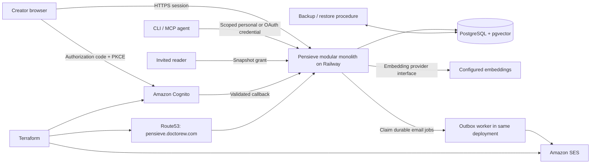
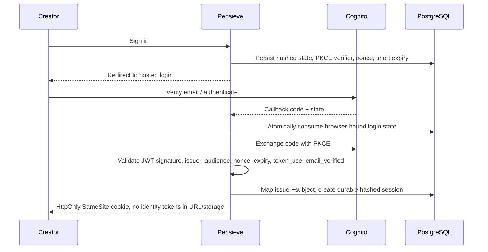
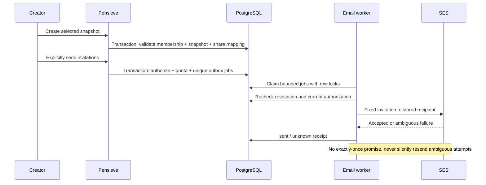

# Hosted Pensieve: one database, customer identity, explicit delivery

Status: implemented and locally verified; deployment pending. Supersedes Cloudflare Access as the customer-login requirement. Local SQLite remains supported. No automatic production cutover.

## Product intent

Executives create, find, curate and email memories from a browser. Engineers use the same authorized pools through CLI/MCP. Anyone with a verified email can create an isolated account. Private is the default; shares grant only the selected snapshot. Existing personal invitations and reader links continue working after migration. Customer identity is Cognito, authorization is Pensieve. No Cloudflare DNS migration or CloudFront requirement.

## Architecture

## Contracts and implementation boundaries

- Introduce awaitable repository contracts derived from the current public TeamStore/ShareStore methods. SQLite adapters remain source-compatible; all hosted callers await storage operations.
- Hosted team, share, session, connector and outbox state share one pg Pool/database. Each transaction owns one checked-out connection, rollback on all failures. Add versioned SQL migrations, serialized by advisory lock. pgvector extension must be available; fail startup when configured hosted storage is unavailable, never silently fall back to SQLite.
- Keep table/column names compatible with existing SQLite tables where practical to simplify verified imports. Preserve issuer/server id, IDs, hashes, timestamps, grants, expiry/revocation, provenance and embedding model identity.
- Add keyset memory pagination (default 50, maximum 100) to hosted UI/API. Explicit selected-ID export is independent of page size. Search enforces pool membership in SQL; vectors use pgvector exact ordering initially, bounded limit. Do not claim HNSW asymptotics; benchmark before approximate indexes. Local behavior remains compatible.
- Share creation must atomically insert snapshot and team mapping on PostgreSQL. No network calls inside DB transactions. Durable email enqueue is separate explicit user action with unique (share,email), fixed message parameters, quotas and revocation checks. Worker records sent/unknown; no retries of ambiguous delivery.
- Cognito uses authorization-code+S256 PKCE, state browser binding, nonce and pinned issuer/client. Require verified email and human subject. Reject tokens for other apps or token types. Never merge accounts by email; explicit legacy-account linking requires proof of personal token and authenticated subject. Keep invitation sign-in during migration.
- Sessions stored hashed in PostgreSQL; bounded per user, expire, revoke and logout survive restarts. Same-origin mutations remain mandatory. Native/MCP clients retain OAuth PKCE/resource binding and personal-token workflow, with durable connector state on the same database.
- Local SQLite CLI mode needs no AWS account or hosted DB. Hosted mode selected by PENSIEVE_DATABASE_URL; the service explicitly announces storage mode without printing credentials.

## Acceptance criteria

1. Versioned PostgreSQL schema creates pgvector and all hosted state tables; repeated/concurrent migration is safe.
2. Existing authorized team CRUD, provenance, policy, embedding/index/search and selected exports work through an awaitable repository; cross-user access fails closed.
3. Memory pagination has stable cursors, bounded page size, no duplicate/omitted rows in a stable dataset, and the browser can load further pages.
4. Cognito flow validates state/nonce/PKCE/signature/issuer/audience/expiry/token_use/verified-email; replay and login-CSRF fail.
5. Hosted sessions survive service restart, logout/revocation persist, accounts stay keyed by issuer+subject, and identity linking requires both credentials.
6. Hosted snapshots and share mappings commit together. Existing reader URLs/tokens/expiry/revocation remain compatible after import.
7. Durable transactional email enqueue applies ACL, recipient and quotas; concurrent sends do not duplicate jobs. Worker restart cannot silently resend an uncertain attempt.
8. MCP tools await hosted storage, and connector clients/grants/tokens persist in PostgreSQL with existing PKCE/resource/redirect checks preserved.
9. SQLite-to-PostgreSQL import is explicit, transactional, idempotent on identical input, rejects conflicting destination rows, preserves IDs/hashes and emits per-table counts without secrets.
10. Backup/restore documentation includes a tested disposable restore, integrity checks, rollback, and honest limits: a pre-cutover SQLite copy cannot include later PostgreSQL writes.
11. Terraform defines Cognito/SES integration and Route53 creator record, keeps DNS cutover disabled by default, and avoids provisioning Cloudflare or CDN for customer login.
12. Unit, real PostgreSQL integration, browser and migration tests pass; independent security/code review has no unresolved blockers. No skipped integration suite may be called successful production proof.

## Files to change / ownership

| Scope | Files |
|---|---|
| Storage architect | src/repositories.ts, src/postgres.ts, src/pg-team-store.ts, src/pg-share-store.ts, src/pg-delivery.ts, migrations/*.sql, test/postgres*.test.ts |
| Identity architect | src/cognito.ts, src/hosted-sessions.ts, test/cognito*.test.ts; owns migrations/002-auth.sql only |
| Connector architect | src/agent-server.ts, src/connector-auth.ts, src/connector-storage.ts, test/connector*.test.ts; owns migrations/003-connector.sql only |
| Root integration | src/team-server.ts, src/identity-routes.ts, src/share-server.ts, src/team-service.ts, src/team-client.ts, src/cli.ts, src/verification-guard.ts, web/team.html, web/team.js, src/migrate-hosted.ts, test/hosted*.test.ts, package.json, pnpm-lock.yaml, Dockerfile, .github/workflows/*, infra/hosted/*, docs/hosted-platform/*, README.md, scripts/prove-hosted-restore.ts |

New files within these scopes are permitted when needed for the same contracts; report scope expansion. Do not modify another owner's files without coordination.

## Migration and rollout

1. Build/test against disposable PostgreSQL. Export and hash source SQLite copies; no reads of a mutating live SQLite file through raw file copy.
2. Provision new hosted DB and Cognito through reviewed configuration; preserve Railway reader hostname. Do not apply paid runtime changes without a concrete cost/configuration estimate.
3. Maintenance window: stop writes, consistent SQLite backups, import all databases in one PG transaction, verify counts/hashes and reader grants.
4. Deploy application with PostgreSQL + Cognito, verify creator and reader flows using isolated accounts. Enable Route53 hostname only after Railway TLS registration.
5. Keep immutable SQLite backups. Before new writes, rollback can restore old app/config. After writes, rollback requires reconciled export/migration; never silently discard new data.

## Works cited (verified code and primary documentation)

- src/team-store.ts: TeamStore transaction, pool membership, provenance, policies, exact cosine search.
- src/team-server.ts: separate ShareStore.create + TeamStore.recordShare compensation; in-memory sessions.
- src/connector-auth.ts and src/agent-server.ts: existing PKCE/resource-bound OAuth and MCP tool contract.
- src/executive.ts: snapshot, invitation hash, recipient challenge and access semantics.
- https://github.com/pgvector/pgvector — exact vs approximate vector indexes and filtering.
- https://docs.aws.amazon.com/cognito/latest/developerguide/authorization-endpoint.html — authorization code and S256 PKCE.
- https://docs.aws.amazon.com/cognito/latest/developerguide/amazon-cognito-user-pools-using-the-id-token.html — ID-token claims.
- https://node-postgres.com/features/transactions — transaction connection ownership.
- https://www.postgresql.org/docs/current/backup-dump.html — logical backup and restore.
- https://aws.amazon.com/cognito/pricing/ and https://railway.com/pricing — current cost inputs, not a measured total.
